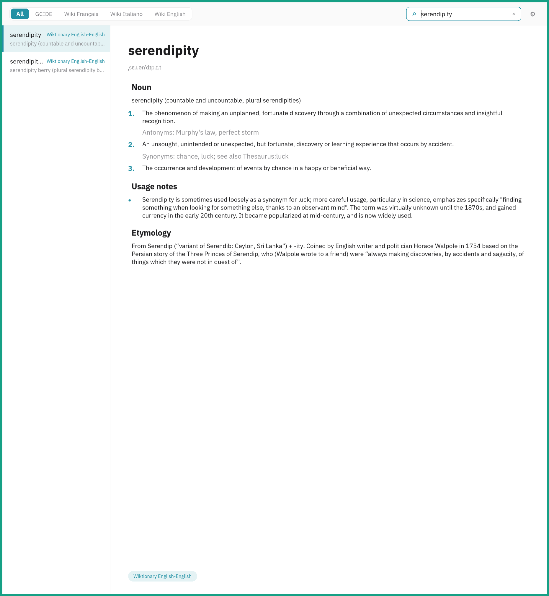
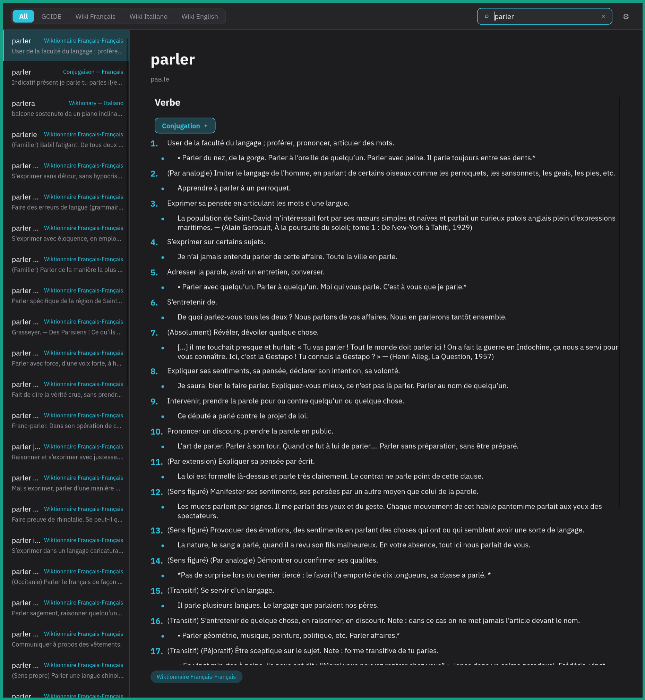

<div align="center">


# IronDict

**Fast local multi-dictionary lookup with fuzzy headword search — CLI and GUI.**

[](LICENSE)


<table>
<tr>
<td></td>
<td></td>
</tr>
</table>

</div>

## About

irondict is a desktop dictionary app written in Rust. It loads
[StarDict](https://en.wikipedia.org/wiki/StarDict) dictionaries and gives you
instant fuzzy and prefix search over their headwords across all of them at once.
The same lookup engine powers two front-ends — a native GUI and a CLI — so you
can search from your desktop or your terminal.

The public-domain [GCIDE](docs/gcide.md) dictionary is bundled, so it works out
of the box. Add your own StarDict files, or download monolingual
[Wiktionary](https://www.wiktionary.org/) dictionaries for several languages
directly from the app.

## Features

- **Two front-ends, one engine** — a native [Slint](https://slint.dev) GUI and a
  clap-based CLI share the same core lookup library.
- **Fuzzy, prefix & exact headword search** across every enabled dictionary at once.
- **Downloadable dictionaries** — install monolingual Wiktionary editions for
  eight languages from a built-in catalog, or add any StarDict file you own.
- **Clickable cross-references** — follow links between entries in the GUI.
- **Verb conjugation** — full conjugation tables for French, Italian and English
  in both front-ends (CLI `conjugate`, GUI panel). The French and Italian tables
  install automatically alongside their Wiktionary dictionary; English ships
  built in.
- **Albert launcher integration** — search your dictionaries from the
  [Albert](https://albertlauncher.github.io/) launcher and jump straight to a
  definition.
- **Bundled GCIDE** dictionary, so it works out of the box.
- **System theme aware** (light/dark via the XDG desktop portal).

## Install

Build from source with a recent stable Rust toolchain:

```sh
git clone https://github.com/DrPandemic/irondict
cd irondict
cargo build --release
```

The single binary lands at `target/release/irondict`. It serves both front-ends:
run a subcommand for the CLI, or pass `--gui` to launch the graphical interface.

## Usage

### GUI

```sh
cargo run --release -p irondict -- --gui
```

### CLI

```sh
# Look up a word across all enabled dictionaries
irondict lookup serendipity

# Search headwords (prefix by default; pass --mode fuzzy for typo tolerance)
irondict search serendipity

# Conjugate a verb — French, Italian or English (language auto-detected)
irondict conjugate manger
irondict conjugate mangiare --lang it

# Download dictionaries from the built-in catalog
irondict catalog            # list what's available
irondict install fr-fr      # download and install by id
irondict uninstall fr-fr    # remove it (files + registration)

# Manage dictionaries
irondict add /path/to/dictionary.ifo
irondict list
irondict enable "Dictionary Name"
irondict disable "Dictionary Name"
irondict remove "Dictionary Name"
```

In the GUI, the same actions live under **Settings → Downloads** (download,
install, delete) and **Settings → Dictionaries** (add, enable, remove).

## Albert launcher

irondict ships a [Albert](https://albertlauncher.github.io/) plugin
([`packaging/albert`](packaging/albert)) so you can search your dictionaries
from the launcher: type a trigger followed by a word to list matching headwords,
and hit Enter to open the irondict GUI straight to that definition (Alt+Enter
copies the word instead).

It registers a general `d ` handler that searches every dictionary, plus one per
language-pinned dictionary keyed by its language code (`de ` English, `df `
French, `di ` Italian by default) — all rebindable under Albert's *Triggers*
settings. Each handler can be switched to fuzzy matching independently.

Install (needs Albert with the Python plugin and `irondict` on `$PATH`):

```sh
cp -r packaging/albert/irondict ~/.local/share/albert/python/plugins/
```

Then enable **Python → IronDict** in Albert's settings. See
[`packaging/albert/README.md`](packaging/albert/README.md) for details.

## Android

The GUI also builds as an Android APK. Toolchain setup (Rust Android targets, `cargo-apk`, JDK, SDK/NDK) is in [`docs/packaging.md`](docs/packaging.md#android-arm64-apk).

### Emulator

Create a Pixel 7 AVD and boot it. On a headless build host, run it without a window and with software rendering:

```sh
avdmanager create avd -n Pixel_7 -k 'system-images;android-37.2;google_apis_playstore_ps16k;x86_64' -d pixel_7
emulator -avd Pixel_7 -no-window -no-audio -gpu swiftshader_indirect &
adb wait-for-device
```

### Build and install

```sh
CARGO_APK_RELEASE_KEYSTORE=~/.android/debug.keystore \
CARGO_APK_RELEASE_KEYSTORE_PASSWORD=android \
cargo apk build -p irondict-android --lib --release --target x86_64-linux-android
adb install -r target/release/apk/irondict-android.apk
adb shell am start -n org.imateapot.irondict/android.app.NativeActivity
adb logcat -s irondict
```

If `~/.android/debug.keystore` doesn't exist yet, create it with `keytool -genkeypair -keystore ~/.android/debug.keystore -storepass android -keypass android -alias androiddebugkey -keyalg RSA -keysize 2048 -validity 10000 -dname "CN=Android Debug,O=Android,C=US"`.

### Viewing a remote headless emulator

[scrcpy](https://github.com/Genymobile/scrcpy) mirrors the emulator to your desktop over SSH. On the desktop, stop the local adb server and tunnel to the build host's:

```sh
adb kill-server
ssh -CN -L5037:localhost:5037 -L27183:localhost:27183 user@build-host
```

Then, in another terminal:

```sh
scrcpy --force-adb-forward
```

Mouse and keyboard input go to the emulator. While the tunnel is up, local `adb` commands (`install`, `logcat`, …) also target the remote emulator. Expect it to feel slow: a headless host renders the emulator in software. When done, stop the tunnel and run `adb kill-server` again before using a local emulator or phone.

## Configuration

Dictionaries and preferences are stored in `~/.config/irondict/config.toml`, and
downloaded dictionaries under `~/.local/share/irondict/dictionaries/`. The search
index is cached under `~/.cache/irondict/` and rebuilt automatically when the
dictionary set changes.

Downloaded dictionaries come from two places: the monolingual editions
published by [xxyzz/wiktionary_stardict](https://github.com/xxyzz/wiktionary_stardict),
and the Italian dictionary plus the French and Italian conjugation companions,
which I build from [kaikki.org](https://kaikki.org/) Wiktextract data and publish
in my own [DrPandemic/wikitionary-dictionaries](https://github.com/DrPandemic/wikitionary-dictionaries)
repository. Both, being derived from Wiktionary, are licensed
[CC BY-SA](https://creativecommons.org/licenses/by-sa/4.0/).

The bundled English irregular-verb table used for conjugation is likewise
derived from the English Wiktionary "English irregular verbs" category (via
[kaikki.org / wiktextract](https://kaikki.org/)) and is licensed
[CC BY-SA 4.0](https://creativecommons.org/licenses/by-sa/4.0/) —
© Wiktionary contributors.

## License

[GPL-3.0-or-later](LICENSE).
